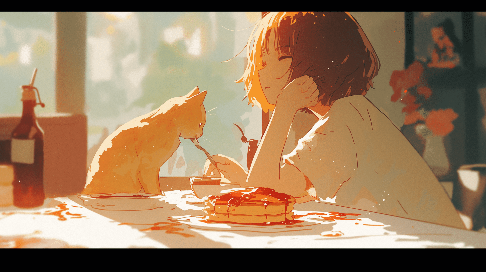

  

<h1 align="center">Welcome to my GitHub profile~ OwO</h1>

  <picture>
    <source media="(prefers-color-scheme: dark)" srcset="./profile/header-dark.svg">
    
  </picture>

  
  
  

❤ I'm currently working on Software and Content Creation.

<h3 align="center">🛠️ Tech Stack</h3>

  <a href="https://github.com/ycvk?tab=repositories"><picture>
    <source media="(prefers-color-scheme: dark)" srcset="https://skillicons.dev/icons?i=go%2Crust%2Cts%2Cpy%2Ckotlin%2Cjava%2Ccpp%2Cdocker%2Csqlite%2Candroidstudio%2Cgodot%2Castro%2Cgithubactions%2Cgit&theme=dark&perline=7">
    
  </picture></a>

<h3 align="center">📊 GitHub Stats</h3>

  <a href="https://github.com/ycvk"><picture>
      <source media="(prefers-color-scheme: dark)" srcset="./profile/stats-dark.svg?v=3">
      
  </picture></a>
  <a href="https://github.com/ycvk?tab=repositories"><picture>
      <source media="(prefers-color-scheme: dark)" srcset="./profile/top-langs-dark.svg?v=3">
      
  </picture></a>

<h3 align="center">🐍 Contribution Snake</h3>

  <picture>
    <source media="(prefers-color-scheme: dark)" srcset="./profile/snake-dark.svg">
    
  </picture>

  <picture>
    <source media="(prefers-color-scheme: dark)" srcset="./profile/footer-dark.svg">
    
  </picture>

